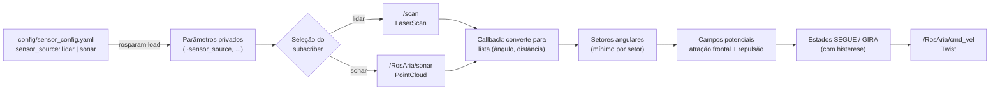

# pioneer_reactive_nav

Navegação reativa autônoma para o **Pioneer 3DX** em **ROS 1**, com seleção do sensor de percepção (**LIDAR** ou **sonars**) feita por arquivo de configuração `.yaml` — sem alterar o código — e ferramentas para a **comparação experimental** dos dois sensores na arena de 7 × 3,5 m.

## Sumário

1. [Visão geral](#1-visão-geral)
2. [Estrutura do repositório](#2-estrutura-do-repositório)
3. [Requisitos](#3-requisitos)
4. [Instalação](#4-instalação)
5. [Arquitetura do nó reativo](#5-arquitetura-do-nó-reativo)
6. [Configuração (`sensor_config.yaml`)](#6-configuração-sensor_configyaml)
7. [Execução com o robô em rede multi-máquina](#7-execução-com-o-robô-em-rede-multi-máquina)
8. [Procedimento experimental e análise](#8-procedimento-experimental-e-análise)
9. [Segurança](#9-segurança)
10. [Solução de problemas](#10-solução-de-problemas)
11. [Autores](#11-autores)

---

## 1. Visão geral

O nó `reactive_avoider.py` mantém o robô em movimento autônomo, desviando de paredes e obstáculos, e publica velocidades (`geometry_msgs/Twist`) no tópico de comando do RosAria.

- O parâmetro `sensor_source` (`"lidar"` ou `"sonar"`) define qual sensor alimenta o controlador.
- Os dois sensores são convertidos para o **mesmo formato** (lista de `(ângulo, distância)`) e reduzidos aos **mesmos setores angulares**. Assim, a lógica de desvio é idêntica nos dois modos e a comparação é justa: só muda a fonte de dados.
- Scripts de análise leem os `rosbag` gravados e geram métricas, gráficos de trajetória, folga ao obstáculo e ruído estático.

## 2. Estrutura do repositório

```
pioneer_reactive_nav/
├── CMakeLists.txt
├── package.xml
├── config/
│   └── sensor_config.yaml        # <- escolha do sensor e parâmetros
├── launch/
│   ├── robot_bringup.launch      # (robô) RosAria + driver do LIDAR + TF
│   ├── reactive_nav.launch       # nó reativo (carrega o .yaml)
│   └── monitor.launch            # (notebook 1) RViz configurado
├── rviz/
│   └── pioneer.rviz
├── scripts/
│   ├── reactive_avoider.py       # controlador reativo
│   ├── analyze_runs.py           # comparação LIDAR x sonar a partir de bags
│   └── static_noise.py           # ruído/confiabilidade com robô parado
├── tools/
│   ├── ros_network.sh            # configura ROS_MASTER_URI / ROS_IP
│   ├── check_network.sh          # diagnóstico da rede multi-máquina
│   └── record_run.sh             # grava os bags de cada experimento
├── data/                         # bags (ignorados pelo git)
└── results/                      # gráficos e CSV gerados
```

## 3. Requisitos

- Ubuntu 20.04 + **ROS Noetic** (Python 3). Para ROS Melodic (Ubuntu 18.04), troque `python3` por `python` na primeira linha de `scripts/reactive_avoider.py`; o controlador é compatível com Python 2. Os scripts de análise exigem Python 3.
- **RosAria** (driver do Pioneer) instalado e funcional — instalação a partir do código-fonte, conforme a [wiki do ROSARIA](http://wiki.ros.org/ROSARIA).
- Driver do LIDAR publicando `sensor_msgs/LaserScan` em `/scan`:
  - **SICK TiM (TiM551, TiM571, ...)**: `sudo apt install ros-noetic-sick-tim`
  - **SICK LMS1xx**: `sudo apt install ros-noetic-lms1xx`
  - **SICK LMS2xx (LMS200/291, serial) — usado neste projeto (LMS291-S05 via RS-232)**: `sudo apt install ros-noetic-sicktoolbox-wrapper`
  - Outros modelos SICK: `sick_scan` (suba manualmente e use `lidar_driver:=none`)
  - RPLIDAR: `sudo apt install ros-noetic-rplidar-ros` · Hokuyo: `sudo apt install ros-noetic-urg-node`
- Ferramentas: `sudo apt install ros-noetic-rviz ros-noetic-rqt-graph ros-noetic-teleop-twist-keyboard python3-numpy python3-matplotlib chrony`
- Permissão nas portas seriais (no robô): `sudo usermod -aG dialout $USER` e faça logout/login.

## 4. Instalação

**Repita em todas as máquinas** (robô e notebooks). O robô precisa do pacote porque os drivers e, de preferência, o nó reativo rodam nele.

```bash
mkdir -p ~/catkin_ws/src && cd ~/catkin_ws/src
git clone https://github.com/<SEU_USUARIO>/pioneer_reactive_nav.git
cd ~/catkin_ws
catkin_make
source devel/setup.bash
echo "source ~/catkin_ws/devel/setup.bash" >> ~/.bashrc
```

Verifique:

```bash
rospack find pioneer_reactive_nav
```

## 5. Arquitetura do nó reativo



**Lógica de controle (a cada `control_rate` Hz):**

1. **Segurança:** se não chegam dados do sensor há mais de `sensor_timeout` s, o robô para.
2. **Setores:** o campo de visão (`fov_deg`) é dividido em setores de `sector_deg` graus; cada setor guarda a menor distância detectada. Isso torna o LIDAR (centenas de feixes) e o sonar (poucos ecos) comparáveis na entrada do controlador.
3. **Campos potenciais:** soma-se uma atração constante para frente (`k_att`) com a repulsão de cada setor ocupado, `k_rep · (1/d − 1/max_range)`, direcionada para longe do obstáculo.
4. **Estado GIRA:** se há obstáculo no cone frontal mais perto que `stop_distance`, ou a força resultante aponta para trás, o robô gira no lugar para o lado mais livre. O sentido é mantido até a frente ficar livre (`clear_distance`), evitando oscilação.
5. **Estado SEGUE:** o ângulo do vetor resultante define a velocidade angular; a velocidade linear cai com o desalinhamento e com a proximidade do obstáculo frontal.

> **Premissas dos sensores:** o RosAria publica os sonars como `PointCloud` com um ponto por eco, em coordenadas do robô. O LIDAR é tratado no referencial do robô com a correção `lidar_angle_offset` (e `lidar_invert`, se montado invertido); a posição do LIDAR em relação ao centro do robô é desprezada no controlador.

## 6. Configuração (`sensor_config.yaml`)

**Para alternar entre LIDAR e sonar, edite apenas `sensor_source`:**

```yaml
sensor_source: "lidar"   # ou "sonar"
```

| Parâmetro | Padrão | Descrição |
|---|---|---|
| `sensor_source` | `lidar` | Fonte de percepção: `lidar` ou `sonar` |
| `lidar_topic` | `/scan` | Tópico do LIDAR |
| `sonar_topic` | `/RosAria/sonar` | Tópico dos sonars (`PointCloud`) |
| `cmd_vel_topic` | `/RosAria/cmd_vel` | Tópico de comando de velocidade |
| `max_range` | 1.5 m | Obstáculos além disso são ignorados |
| `fov_deg` | 200° | Campo de visão usado, centrado na frente |
| `sector_deg` | 10° | Largura dos setores angulares |
| `front_half_deg` | 30° | Meia-abertura do cone frontal |
| `lidar_angle_offset` | 0.0 rad | Giro do LIDAR em relação ao robô |
| `lidar_invert` | false | LIDAR montado de cabeça para baixo |
| `lidar_min_range` | 0.12 m | Ignora leituras no corpo do robô |
| `v_max` / `w_max` | 0.25 m/s / 0.8 rad/s | Limites de velocidade |
| `k_att` / `k_rep` / `k_w` | 1.0 / 0.3 / 1.5 | Ganhos de atração, repulsão e angular |
| `stop_distance` | 0.40 m | Abaixo disso à frente, gira no lugar |
| `clear_distance` | 0.65 m | Distância para considerar a frente livre |
| `slow_distance` | 1.0 m | Abaixo disso, reduz a velocidade linear |
| `control_rate` | 10 Hz | Frequência do laço de controle |
| `sensor_timeout` | 1.0 s | Sem dados do sensor, o robô para |

Os parâmetros de percepção (`max_range`, `fov_deg`, `sector_deg`) são **compartilhados** pelos dois sensores. Mantenha-os iguais nos dois testes para que a comparação seja válida.

---

## 7. Execução com o robô em rede multi-máquina

### 7.1 Topologia

| Máquina | Função | O que roda |
|---|---|---|
| **Robô** (PC embarcado do Pioneer) | Master ROS + hardware | `roscore`, `robot_bringup.launch` (RosAria + LIDAR) e, de preferência, `reactive_nav.launch` |
| **Notebook 1** | Visualização | `monitor.launch` (RViz) |
| **Notebook 2** | Inspeção textual e gravação | `rostopic hz`, `rqt_graph`, `rosbag record`, teleoperação de emergência |

> **Por que o nó reativo deve rodar no robô?** O laço de controle depende de dados de sensores e de comandos de velocidade. Rodando no próprio PC embarcado, ele não sofre com latência, perda de pacotes ou queda do Wi-Fi. Os notebooks apenas observam e gravam. Se precisar rodar o nó em um notebook (opção B, abaixo), o RosAria para o robô automaticamente se os comandos pararem de chegar — confira o parâmetro `cmd_vel_timeout` do RosAria.

### 7.2 Passo 1 — Conectar todos à mesma rede e descobrir os IPs

Conecte o PC do robô e os dois notebooks à **mesma rede Wi-Fi** do laboratório. Em cada máquina:

```bash
hostname -I
```

Anote (exemplo):

| Máquina | IP |
|---|---|
| Robô | `192.168.0.10` |
| Notebook 1 | `192.168.0.21` |
| Notebook 2 | `192.168.0.22` |

Teste a conectividade entre elas:

```bash
ping -c 3 192.168.0.10     # a partir de cada notebook
```

> Redes com "isolamento de clientes" (AP isolation) bloqueiam a comunicação entre máquinas. Se o `ping` falhar, peça ao responsável pela rede para desativar esse recurso ou use um roteador dedicado.

### 7.3 Passo 2 — Instalar o pacote em todas as máquinas

Siga a [Instalação](#4-instalação) no robô e nos dois notebooks.

### 7.4 Passo 3 — Variáveis de ambiente ROS

Em **cada terminal** de **cada máquina**, informe apenas o IP do robô (o `ROS_IP` local é descoberto automaticamente):

```bash
cd ~/catkin_ws/src/pioneer_reactive_nav
source tools/ros_network.sh 192.168.0.10
```

Saída esperada (no notebook 1, por exemplo):

```
[ros_network] ROS_MASTER_URI = http://192.168.0.10:11311
[ros_network] ROS_IP         = 192.168.0.21
```

O resultado equivale a configurar manualmente:

| Máquina | `ROS_MASTER_URI` | `ROS_IP` |
|---|---|---|
| Robô | `http://192.168.0.10:11311` | `192.168.0.10` |
| Notebook 1 | `http://192.168.0.10:11311` | `192.168.0.21` |
| Notebook 2 | `http://192.168.0.10:11311` | `192.168.0.22` |

Para não repetir o comando a cada terminal, acrescente ao final do `~/.bashrc` (ajustando o IP do robô; as linhas funcionam em qualquer máquina):

```bash
source ~/catkin_ws/src/pioneer_reactive_nav/tools/ros_network.sh 192.168.0.10
```

> Se a detecção automática falhar (ex.: várias interfaces de rede), passe a interface: `source tools/ros_network.sh 192.168.0.10 wlp3s0`.

### 7.5 Passo 4 — Iniciar o master no robô

No **robô** (por SSH, se preferir: `ssh usuario@192.168.0.10`):

```bash
source ~/catkin_ws/src/pioneer_reactive_nav/tools/ros_network.sh 192.168.0.10
roscore
```

Deixe esse terminal aberto durante todo o experimento.

### 7.6 Passo 5 — Validar a comunicação pub/sub

Em um terminal do **Notebook 1** e outro do **Notebook 2**, com as variáveis configuradas (Passo 3):

```bash
# Notebook 1 (publica)
rostopic pub /teste std_msgs/String "data: 'ola do notebook 1'" -r 1

# Notebook 2 (assina)
rostopic echo /teste
```

Se o Notebook 2 imprimir a mensagem, a rede ROS está funcionando. Pare o `rostopic pub` com `Ctrl+C`. Para um diagnóstico completo (ping, porta 11311, nós visíveis, taxas dos sensores):

```bash
tools/check_network.sh
```

**Entregável da Fase 1:** diagrama da rede (3 máquinas, IPs, master no robô) e captura de tela do teste acima.

### 7.7 Passo 6 — Iniciar os drivers no robô

Com o Pioneer ligado, conectado por USB-serial e o LIDAR ligado, no **robô** (novo terminal, com as variáveis do Passo 3):

```bash
roslaunch pioneer_reactive_nav robot_bringup.launch
```

Argumentos principais (ajuste conforme o hardware do laboratório). O padrão é `lidar_driver:=lms2xx` (SICK LMS291-S05 por RS-232):

```bash
# SICK TiM571 por USB
roslaunch pioneer_reactive_nav robot_bringup.launch \
    port:=/dev/ttyUSB0 lidar_driver:=sick_tim sick_tim_node:=sick_tim571_2050101

# SICK TiM551 por Ethernet (IP do sensor em sick_hostname)
roslaunch pioneer_reactive_nav robot_bringup.launch \
    lidar_driver:=sick_tim sick_tim_node:=sick_tim551_2050001 sick_hostname:=192.168.0.1

# SICK LMS1xx (Ethernet)
roslaunch pioneer_reactive_nav robot_bringup.launch lidar_driver:=lms1xx lms_host:=192.168.0.1

# SICK LMS291-S05 por RS-232 (padrão do projeto)
roslaunch pioneer_reactive_nav robot_bringup.launch \
    port:=/dev/ttyUSB0 lidar_driver:=lms2xx lms2xx_port:=/dev/ttyUSB1 lms2xx_baud:=38400

# Driver iniciado manualmente (ex.: sick_scan)
roslaunch pioneer_reactive_nav robot_bringup.launch lidar_driver:=none
```

#### Notas para o SICK LMS291-S05 (RS-232)

- **Alimentação:** o LMS291 precisa de **24 V DC** (confirme no manual). O Pioneer fornece 12 V, então é necessário um conversor DC-DC ou fonte própria. Sem a alimentação correta o sensor não responde.
- **Baud rate:** o driver `sicklms` aceita 9600, 19200, 38400 e 500000. Pela RS-232 use **38400** (padrão do launch). 500000 exige adaptador RS-422/USB.
- **Taxa de scan limitada pela serial:** a 38400 baud o LMS291 entrega bem menos scans por segundo do que LIDARs modernos (os ~75 Hz do datasheet só valem a 500 kbaud). Meça com `rostopic hz /scan`. Se a taxa ficar abaixo de ~1 Hz, aumente `sensor_timeout` no `.yaml`. **Registre essa taxa no relatório**, pois ela entra diretamente na comparação "taxa de atualização" LIDAR × sonar.
- **Campo de visão e resolução:** 180° com 1° de resolução (padrão do launch: `lms2xx_angle:=180`, `lms2xx_resolution:=1.0`). O controlador usa ±100° e agrupa as leituras em setores de 10°, então os 180° do LMS são suficientes.
- **Porta serial estável:** o Pioneer (RosAria) e o SICK usam dois adaptadores USB-serial, e os números `ttyUSB0`/`ttyUSB1` podem trocar após reiniciar. Use um nome fixo: `ls -l /dev/serial/by-id/` e passe o caminho completo em `port:=` e `lms2xx_port:=`. Se usar uma serial nativa, a porta costuma ser `/dev/ttyS0`.
- **Permissão:** `sudo usermod -aG dialout $USER` e novo login.
- **Se o driver não conectar:** desligue e ligue o LMS (o sensor mantém o último baud configurado), confirme a porta e o baud e inicie o launch de novo.
- **Frame do scan:** confirme com `rostopic echo -n1 /scan/header/frame_id` e use o mesmo valor em `lidar_frame` (padrão `laser`), senão o RViz não alinha o scan ao robô.
- **Orientação:** se os obstáculos aparecerem girados ou espelhados no RViz, ajuste `lidar_angle_offset`/`lidar_invert` em `sensor_config.yaml` (e `laser_yaw` no launch). Use `lidar_invert` do `.yaml` em vez do parâmetro `inverted` do driver.
- **Leituras inválidas:** o SICK pode publicar `inf`, `NaN` ou `0` sem retorno; o controlador já descarta esses valores.

#### Notas para outros SICK (TiM e LMS1xx, Ethernet)

- O nome do executável de `sick_tim` segue o modelo; liste as opções com `ls $(rospack find sick_tim)/launch`. Para USB, instale as regras udev do pacote.
- O IP padrão de fábrica do TiM5xx e do LMS1xx é `192.168.0.1`, que **conflita** com a rede Wi-Fi se ela usar `192.168.0.x`. Use uma sub-rede própria na Ethernet do sensor e mantenha o `ROS_IP` do robô no IP do Wi-Fi.

Ajuste também a posição do LIDAR em relação ao centro do robô: `laser_x`, `laser_y`, `laser_z`, `laser_yaw`.

Em outro terminal do robô, **habilite os motores**:

```bash
rosservice call /RosAria/enable_motors "{}"
```

Confira os tópicos a partir de qualquer notebook:

```bash
rostopic list | grep -E "scan|RosAria"
```

Esperado: `/scan`, `/RosAria/sonar`, `/RosAria/pose`, `/RosAria/cmd_vel`.

### 7.8 Passo 7 — Monitoramento remoto duplo

**Notebook 1 — RViz:**

```bash
roslaunch pioneer_reactive_nav monitor.launch
```

Mostra o LIDAR (vermelho), os ecos dos sonars (verde), a TF e a odometria, com *Fixed Frame* = `odom`. Confirme que os obstáculos aparecem na direção correta: se o LIDAR estiver girado, corrija com `lidar_angle_offset` em `sensor_config.yaml`.

**Notebook 2 — ferramentas de texto:**

```bash
rostopic hz /scan
rostopic hz /RosAria/sonar
rostopic hz /RosAria/pose
rqt_graph
```

Anote as taxas: serão usadas no relatório (seção de ruído e taxa de atualização).

**Entregável da Fase 2:** captura de tela integrada, mostrando o RViz (notebook 1) e o terminal com `rostopic hz`/`rqt_graph` (notebook 2).

### 7.9 Passo 8 — Executar o nó de navegação reativa

#### Opção A (recomendada): nó executando no robô

No **robô** (terminal com as variáveis ROS):

```bash
# 1. Edite o sensor desejado
nano ~/catkin_ws/src/pioneer_reactive_nav/config/sensor_config.yaml    # sensor_source: "lidar"

# 2. Inicie o nó
roslaunch pioneer_reactive_nav reactive_nav.launch
```

Os notebooks continuam monitorando o comportamento pelo RViz e pelas ferramentas de texto. O log do nó mostra o sensor ativo no início:

```
Fonte de percepcao: LIDAR | topico: /scan | saida: /RosAria/cmd_vel
```

Para disparar o nó a partir de um notebook, sem sair dele:

```bash
ssh usuario@192.168.0.10
source ~/catkin_ws/src/pioneer_reactive_nav/tools/ros_network.sh 192.168.0.10
roslaunch pioneer_reactive_nav reactive_nav.launch
```

#### Opção B: nó executando em um notebook

No notebook (com as variáveis do Passo 3 e o pacote compilado):

```bash
roslaunch pioneer_reactive_nav reactive_nav.launch
```

Funciona, pois os tópicos atravessam a rede ROS, mas os dados do LIDAR trafegam pelo Wi-Fi (mensagens de `/scan` são grandes). Latência e perdas de pacote afetam o desempenho do robô, e isso contaminaria a comparação entre sensores. **Use a opção A nos testes oficiais.**

### 7.10 Passo 9 — Alternar o sensor (sem mexer no código)

1. Pare o nó (`Ctrl+C`; o robô recebe velocidade zero).
2. Edite **somente** `sensor_source` em `config/sensor_config.yaml` (no PC onde o nó roda).
3. Rode novamente `roslaunch pioneer_reactive_nav reactive_nav.launch`.

Para um teste rápido, sem editar o arquivo (não usar nos testes oficiais):

```bash
roslaunch pioneer_reactive_nav reactive_nav.launch sensor_source:=sonar
```

### 7.11 Encerramento

1. `Ctrl+C` no nó reativo (o robô para).
2. Desabilite os motores: `rosservice call /RosAria/disable_motors "{}"`.
3. `Ctrl+C` no `robot_bringup.launch` e, por último, no `roscore`.

---

## 8. Procedimento experimental e análise

### 8.1 Preparação da arena

Delimite a arena de 7 × 3,5 m e posicione os obstáculos (por exemplo: caixa grande, caixa pequena, perna de cadeira ou cano fino, e uma superfície inclinada). **Use o mesmo layout, a mesma posição/orientação inicial e a mesma duração (ex.: 3 min) em todas as execuções**, com 2 a 3 repetições por sensor.

### 8.2 Execuções

Em um terminal do notebook 2 (variáveis ROS configuradas):

```bash
# Teste 1: LIDAR (sensor_source: "lidar")
tools/record_run.sh lidar_run1 180
```

Em paralelo, inicie o nó no robô (`roslaunch pioneer_reactive_nav reactive_nav.launch`). Repita para `lidar_run2`, `lidar_run3`.

Depois troque **apenas** o parâmetro para `sensor_source: "sonar"` e repita:

```bash
tools/record_run.sh sonar_run1 180
```

O `record_run.sh` grava `/scan`, `/RosAria/sonar`, `/RosAria/pose`, `/RosAria/cmd_vel` e `/tf` em `data/<nome>.bag`. Os dois sensores são gravados em todas as execuções, o que permite avaliar, com o LIDAR, a folga real nos testes feitos só com sonar.

### 8.3 Ruído e confiabilidade (robô parado)

Com o robô parado e um obstáculo fixo à frente:

```bash
tools/record_run.sh parado 30
rosrun pioneer_reactive_nav static_noise.py data/parado.bag --out results/
```

Reporta, para cada sensor, taxa efetiva, percentual de leituras inválidas, desvio-padrão e distribuição dos ecos frontais.

### 8.4 Comparação das execuções

```bash
rosrun pioneer_reactive_nav analyze_runs.py \
    data/lidar_run1.bag data/sonar_run1.bag \
    --labels LIDAR SONAR --out results/
```

Gera em `results/`:

| Arquivo | Conteúdo |
|---|---|
| `summary.csv` | Duração, distância percorrida, velocidade média, cobertura estimada da arena, taxas dos tópicos, folga mínima, número de quase-colisões, % do tempo parado/girando |
| `trajetorias.png` | Trajetórias (odometria) sobrepostas |
| `folga.png` | Distância mínima ao obstáculo ao longo do tempo (LIDAR e sonar) |
| `comandos.png` | `v` e `w` comandados ao longo do tempo |

Opções úteis: `--near 0.30` (limiar de quase-colisão, em metros), `--cell 0.5` (célula da métrica de cobertura) e `--arena 7 3.5`.

### 8.5 Roteiro para o relatório comparativo

| Tópico exigido | O que usar |
|---|---|
| **Resolução espacial** | Obstáculos finos (perna de cadeira, cano) detectados ou não; ecos no RViz; suavidade das trajetórias (`trajetorias.png`) |
| **Zonas cegas e alcance** | `folga_min_*` e `quase_colisoes_lidar`; comportamento perto de paredes inclinadas (reflexão especular dos sonars) e de obstáculos muito próximos |
| **Ruído e taxa de atualização** | Saída de `static_noise.py`; `rostopic hz`; `taxa_scan_hz` e `taxa_sonar_hz` em `summary.csv`. Lembre que o LMS291 via RS-232 a 38400 baud tem taxa de scan limitada pela serial |
| **Desempenho geral** | `distancia_percorrida_m`, `cobertura_estimada_pct`, `pct_tempo_parado_ou_girando` |

Observação: a odometria acumula erro de deriva. Trate as trajetórias como aproximadas e compare execuções curtas e com a mesma posição inicial.

---

## 9. Segurança

- **Primeiro teste com o robô suspenso** (rodas no ar) e `v_max` baixo (por exemplo, 0.10).
- Mantenha uma pessoa com acesso ao **botão de emergência** do Pioneer durante todos os testes.
- Deixe a teleoperação pronta em um notebook para retomar o controle:
  ```bash
  rosrun teleop_twist_keyboard teleop_twist_keyboard.py cmd_vel:=/RosAria/cmd_vel
  ```
  Pare o nó reativo antes de teleoperar, pois ambos publicam no mesmo tópico.
- O nó para o robô se o sensor deixar de publicar (`sensor_timeout`) e publica velocidade zero ao ser encerrado.
- Sonars e LIDAR têm zonas cegas: obstáculos abaixo/acima do plano do LIDAR (por exemplo, mesas) não são vistos por ele.

## 10. Solução de problemas

| Sintoma | Causa provável e solução |
|---|---|
| `Unable to communicate with master!` | `roscore` não está rodando ou `ROS_MASTER_URI` está errado. Rode `tools/check_network.sh`. |
| `rostopic list` funciona, mas `echo`/`hz` não recebem dados | `ROS_IP` incorreto ou ausente na máquina que publica ou assina. Reconfigure com `tools/ros_network.sh`. Se persistir, adicione os nomes das máquinas ao `/etc/hosts` de todas elas. |
| `ping` funciona, mas porta 11311 fecha | Firewall. Para teste: `sudo ufw disable`; depois libere as portas. |
| Erros de TF / "extrapolation into the future" | Relógios dessincronizados. Instale e ative `chrony` em todas as máquinas. |
| `/RosAria/sonar` não publica | Sonars desabilitados ou ausentes. Confira com `rostopic list` e no RViz; verifique a configuração do robô. |
| Sonars aparecem em posição errada no RViz | O controlador assume pontos do sonar em coordenadas do robô. Verifique o `frame_id` da nuvem e a TF correspondente. |
| Obstáculos do LIDAR aparecem girados/espelhados | Ajuste `lidar_angle_offset` e/ou `lidar_invert` em `sensor_config.yaml`. |
| `/scan` não aparece com o LMS291 | Confira a alimentação de 24 V, a porta (`/dev/serial/by-id/`), o baud (38400 em RS-232) e as permissões (`dialout`); desligue/ligue o LMS e rode o launch de novo. Mensagens `Baud rate must be in {9600, 19200, 38400, 500000}` indicam baud inválido. |
| `Permission denied: /dev/ttyUSB0` | `sudo usermod -aG dialout $USER` e novo login. |
| Robô não se move | Motores desabilitados: `rosservice call /RosAria/enable_motors "{}"`. Confirme o tópico com `rostopic echo /RosAria/cmd_vel`. |
| Robô para sozinho com `Sem dados do sensor` | O sensor selecionado não está publicando. Confira `rostopic hz` do tópico. |
| Robô gira demais / roça nas paredes | Ajuste `stop_distance`, `clear_distance`, `k_rep` e `max_range` (iguais nos dois sensores). |

## 11. Autores

Grupo: `<Nome 1>`, `<Nome 2>`, `<Nome 3>`, `<Nome 4>`
Disciplina: `<Disciplina / Professor / Semestre>`
Licença: MIT
